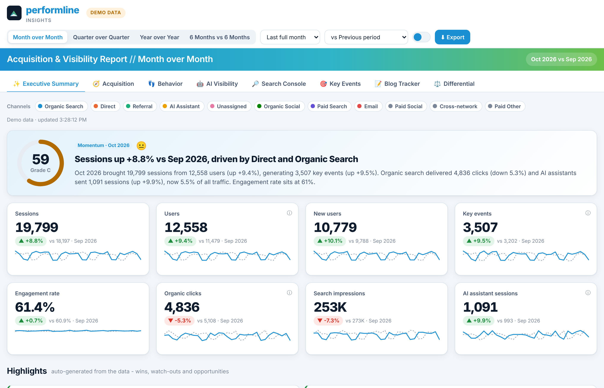
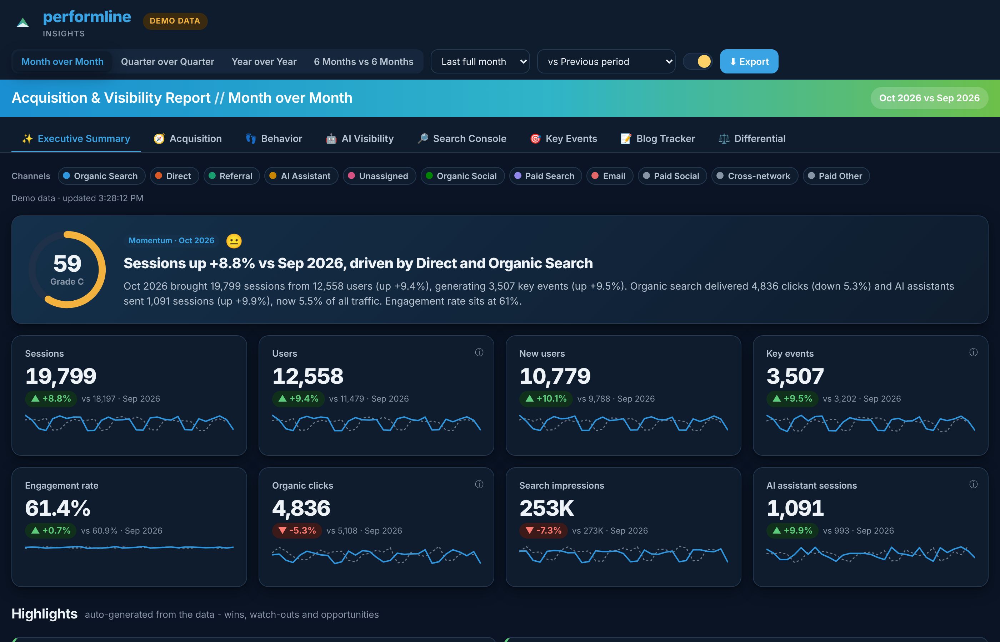
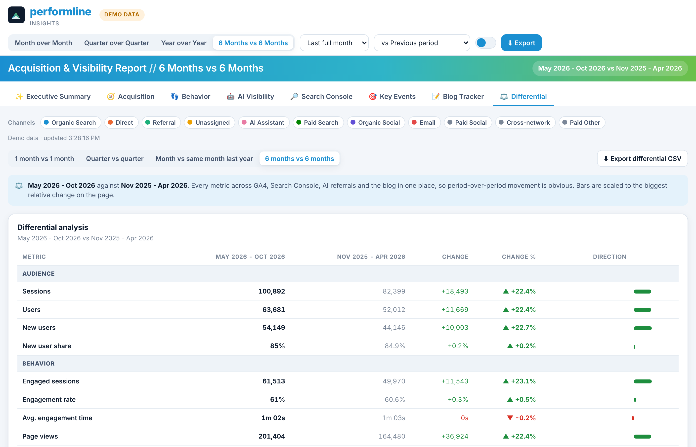
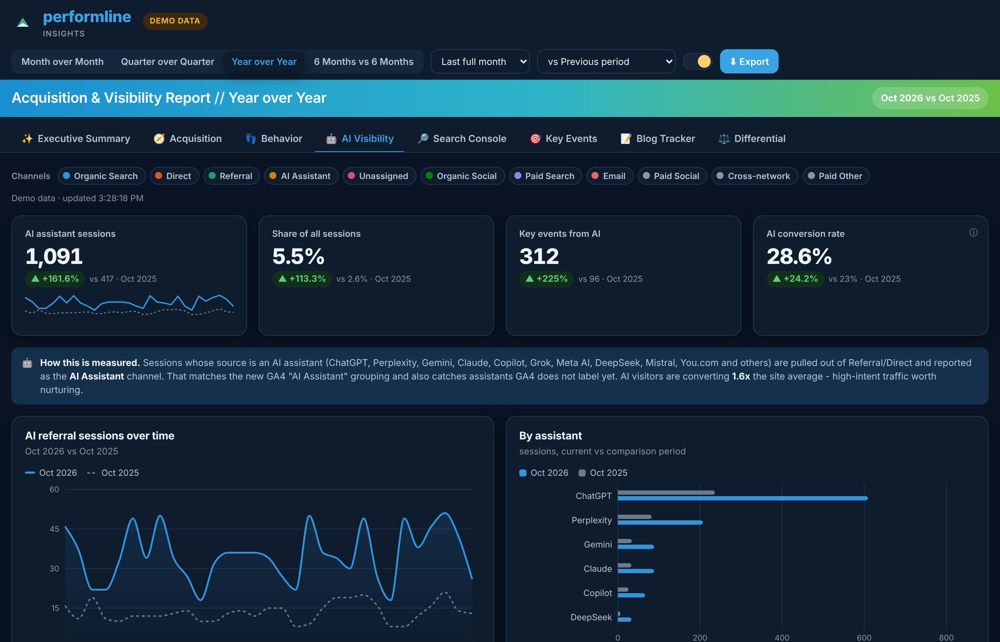

# PerformLine Insights

An interactive acquisition, behavior, AI-visibility and blog reporting system for [PerformLine](https://performline.com), built on **Google Analytics 4** and **Google Search Console** — in the spirit of the Adsitco differential reports and BrandWide PDF exports, branded with PerformLine's blue-to-green palette, with light and dark modes.



| Dark mode | Differential (6 months vs 6 months) | AI visibility |
| --- | --- | --- |
|  |  |  |

## What's inside

| Tab | What it answers |
| --- | --- |
| ✨ **Executive Summary** | Momentum score, auto-written headline + narrative, wins / watch-outs / opportunities, the Data-Studio-style "where do visitors land" and "top drivers of traffic" tables, executive notes |
| 🧭 **Acquisition** | Sessions / users / new users / key events, stacked channel mix over time, channel comparison, channel table with conversion rate, source/medium table, device split |
| 👣 **Behavior** | Engagement rate, average engagement time, views per session, event count, landing-page performance, most and least engaging pages |
| 🤖 **AI Visibility** | Referrals from ChatGPT, Perplexity, Gemini, Claude, Copilot, Grok, DeepSeek and others broken out as an **AI Assistant** channel; share of traffic, conversion rate vs site, assistant breakdown, pages assistants cite |
| 🔎 **Search Console** | Clicks, impressions, CTR, position; branded vs non-branded; striking-distance keywords; top queries, pages, devices, countries |
| 🎯 **Key Events** | GA4 key events as conversions (`demo-submission`, `form_submit`, `form_start`, `file_download`, `click`, `purchase`), by event and a channel × event conversion matrix |
| 📝 **Blog Tracker** | Every post with GA4 engagement, Search Console clicks/impressions, AI referrals, NEW badges, rising / falling posts, blog channel mix |
| ⚖️ **Differential** | Adsitco-style period-over-period table across every metric, with 1 month vs 1 month, quarter vs quarter, year over year and 6 months vs 6 months switches, plus winners & losers for pages, queries, posts and sources |

Across every tab:

- **Period presets** — Month over Month, Quarter over Quarter, Year over Year, 6 Months vs 6 Months, plus month-to-date, quarter-to-date, year-to-date, last 3/6/12 months and custom ranges, each compared against the previous period or the same period last year.
- **Channel toggles** — click a chip to switch a channel off (double-click to isolate one). Every KPI, chart and table recomputes client-side.
- **Light / dark mode** — toggle in the header; the choice is remembered. Chart palette validated for colour-vision deficiency in both modes.
- **Export** — server-rendered **PDF** of the full report (all tabs, your notes included), browser print-to-PDF fallback, CSV export on every table, and shareable links that keep period, channels and tab.
- **Notes & context** — analyst notes per tab, stored in the browser and printed into exports.
- Demo mode: without credentials the app serves deterministic sample data shaped like PerformLine's traffic so the whole thing works instantly.

## Quick start

```bash
npm install
npm run dev
```

Open <http://localhost:5173>. The server runs on port 8787 in **demo mode** until you add credentials.

### Connect GA4 + Search Console

1. Copy `.env.example` to `.env`.
2. Follow [docs/SETUP.md](docs/SETUP.md) to create a Google service account and grant it read access to the GA4 property and the Search Console property.
3. Set `DATA_MODE=live`, `GA4_PROPERTY_ID`, `GSC_SITE_URL` and either `GOOGLE_APPLICATION_CREDENTIALS` or `GOOGLE_SERVICE_ACCOUNT_JSON`.
4. Restart. The header pill switches from "Demo data" to "Live GA4 + GSC".

### Production

```bash
npm run build      # builds the client into client/dist
npm start          # Express serves the API and the built client on $PORT
```

Or with Docker:

```bash
docker build -t performline-insights .
docker run -p 8787:8787 --env-file .env performline-insights
```

The Docker image includes Chromium so the PDF export works out of the box. On other hosts install Playwright's browser (`npx playwright install chromium`) or point `CHROMIUM_PATH` at a system Chrome; if neither is available the export button falls back to the browser print dialog.

## Project layout

```
server/          Express API (ESM, Node 20+)
  src/connectors/ga4.js   GA4 Data API queries (two date ranges per request)
  src/connectors/gsc.js   Search Console Search Analytics queries
  src/demo/generator.js   Deterministic demo data
  src/periods.js          Period presets + comparison maths (unit tested)
  src/ai.js               AI assistant referral classification
  src/report.js           Report assembly + TTL cache
  src/export.js           Playwright PDF rendering
client/          Vite + React + TypeScript dashboard
  src/lib/compute.ts      Client-side aggregation (channel filters, bucketing, KPIs)
  src/lib/summary.ts      Rule-based executive summary / insights
  src/tabs/               One component per report tab
  src/PrintView.tsx       All tabs stacked for PDF/print
docs/SETUP.md    Google Cloud, GA4 and Search Console setup
```

## API

- `GET /api/config` — mode, presets, quick views, key events
- `GET /api/report?view=mom|qoq|yoy|h6` or `?preset=last_6_months&compare=previous_year` or `?preset=custom&start=YYYY-MM-DD&end=YYYY-MM-DD`
- `POST /api/export/pdf` — `{ search, notes, theme, filename }` → PDF
- `POST /api/cache/clear`

## Scripts

| Command | What it does |
| --- | --- |
| `npm run dev` | Server (watch) + Vite dev server with API proxy |
| `npm run build` | Typecheck and build the client |
| `npm start` | Serve API + built client |
| `npm test` | Server unit tests (period maths, demo data, AI classification) |
| `npm run typecheck` | TypeScript check for the client |
